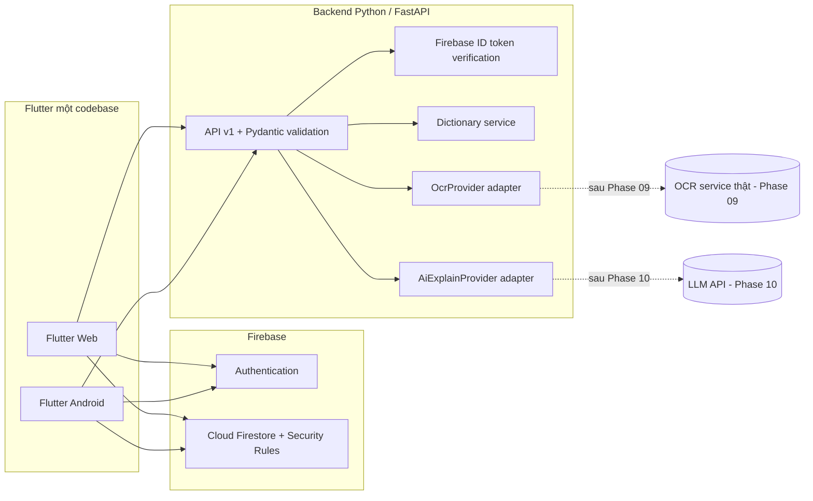

# HanLearn AI — kiến trúc hệ thống đề xuất

> Issue `HL-00-04` · 2026-11-20 · Phạm vi: thiết kế thành phần và luồng dữ liệu. Schema chi tiết thuộc `HL-00-05`; API contract chi tiết thuộc `HL-00-06`.

## 1. Ràng buộc kiến trúc

1. **Một codebase Flutter/Dart/Riverpod** biên dịch cho Flutter Web và Flutter Android. Chức năng người dùng phải được kiểm chứng trên cả hai target.
2. **Backend ứng dụng bằng Python/FastAPI/Pydantic.** Backend cung cấp API từ điển, OCR và AI, xác thực Firebase ID token tại endpoint có dữ liệu/quota cá nhân; không tin UID client tự gửi.
3. Firebase Authentication quản lý phiên; Cloud Firestore lưu từ điển chung và dữ liệu học cá nhân theo UID; Security Rules ngăn truy cập chéo tài khoản.
4. OCR và AI là tích hợp cuối. Trước Phase 09/10, Flutter dùng nhập tay, backend chỉ có contract/adapter mock để kiểm thử; không trả kết quả giả dưới nhãn service thật.
5. OCR service có thể là service riêng hoặc PaddleOCR nội bộ. AI dùng API key chỉ ở backend; provider/model chưa chốt.

## 2. Sơ đồ hệ thống



Flutter có thể đọc/ghi Firestore trực tiếp cho dữ liệu người dùng khi Rules cho phép; backend **không tạo CRUD trùng lặp** nếu không có lý do thiết kế. Backend từ điển đọc corpus/nguồn dữ liệu chung theo phương án Phase 03; lưu nguồn và bản quyền. Cấu hình runtime tách local/staging/production, không hardcode URL hoặc secret.

## 3. Trách nhiệm từng thành phần

| Thành phần | Trách nhiệm | Không chịu trách nhiệm |
|---|---|---|
| Flutter `core/` | Router, theme, config, network client, lỗi chung, trạng thái auth | Chứa API key hoặc service account |
| Flutter `features/` | Auth, nhập tay, dictionary, saved words, flashcards, quiz, progress, scanner | Quyết định quyền truy cập dữ liệu thay Security Rules |
| Firebase Auth | Danh tính/ID token, auth persistence | Tin UID do form tự nhập |
| Firestore + Rules | Dữ liệu học theo UID, từ điển chung nếu chọn lưu tại đây, đồng bộ Web/Android | Xử lý ảnh OCR/LLM secret |
| FastAPI `api/v1/` | HTTP contract, input validation, auth dependency, error mapping | Lưu key trong source code |
| Backend services | Tra từ, điều phối OCR/AI, validation/fallback, quota | Tạo dữ liệu từ điển không có nguồn |
| `OcrProvider` | Giao diện chung để gọi OCR service nội bộ/ngoài | Giả định provider cụ thể trước Phase 09 |
| `AiExplainProvider` | Gọi LLM API bằng secret phía server và trả đầu ra kiểm tra | Thay thế nghĩa/Pinyin của corpus nguồn |

## 4. Luồng dữ liệu chính

### 4.1 Core — tra và học không phụ thuộc OCR/AI

1. Flutter Web hoặc Android đăng nhập qua Firebase Auth, nhận phiên/ID token.
2. Người dùng nhập/dán Hanzi/Pinyin; Flutter gọi API dictionary của backend Python. Backend tra corpus có nguồn và trả kết quả có schema. Từ không có trong corpus được báo rõ, không tạo nghĩa bằng AI.
3. Người dùng lưu/bỏ lưu; Flutter thao tác `users/{uid}/saved_words/{vocabId}` qua Firestore SDK, Security Rules kiểm `request.auth.uid == uid`. Dữ liệu tự đồng bộ giữa hai target cùng UID.
4. Flashcard/Quiz/lịch ôn dùng từ đã lưu và ghi `review_schedule`/`quiz_results` theo UID; thuật toán chốt ở Phase 04. Dashboard tổng hợp từ dữ liệu cá nhân với truy vấn có giới hạn.

### 4.2 Ảnh và OCR — Phase 06 UI, Phase 09 service thật

1. Web chọn file; Android dùng camera/gallery. Client preview và kiểm tra sơ bộ định dạng/kích thước.
2. Trước Phase 09, UI thông báo OCR chưa cấu hình và cho nhập tay; không lưu ảnh vào Firestore.
3. Sau Phase 09, Flutter gửi ảnh multipart đến backend Python qua HTTPS khi public. Backend giới hạn byte/pixel, chuẩn hóa orientation, kiểm auth nếu endpoint/scan history cá nhân, rồi gọi `OcrProvider` thật.
4. Backend trả text/detections/confidence/latency hoặc lỗi chuẩn; Flutter hiển thị để sửa. Chỉ khi người dùng xác nhận mới ghi text vào `scan_history`, rồi chuyển sang tra từ.
5. Ảnh chỉ dùng tạm cho xử lý, không lưu lâu dài mặc định. Chính sách retention chi tiết cần chốt trước tích hợp nếu service ngoài lưu dữ liệu.

### 4.3 Giải thích AI — Phase 10

1. Từ Dictionary Detail có mục từ đã xác minh, Flutter gửi từ/ngữ cảnh đến backend (kèm ID token nếu quota cá nhân).
2. Backend áp quota/rate limit, gọi `AiExplainProvider` bằng key server, validate JSON/Pydantic và giới hạn nội dung. Không log key hoặc dữ liệu nhạy cảm.
3. Flutter hiển thị card gắn nhãn AI. Timeout/quota/đầu ra không hợp lệ → chỉ hiển thị từ điển; không làm hỏng luồng học.

## 5. Biên bảo mật và lỗi

| Biên | Kiểm soát |
|---|---|
| Flutter ↔ Firestore | Security Rules theo UID/field/type; từ điển chung client chỉ đọc; test hai tài khoản qua Emulator Suite |
| Flutter ↔ FastAPI | HTTPS nếu public, CORS theo origin Web cho phép, validation Pydantic, timeout, error code chuẩn |
| Firebase token ↔ backend | Verify signature/expiry/audience bằng Firebase Admin hoặc phương án chính thức; UID lấy từ token đã xác minh |
| Backend ↔ OCR/AI service | Endpoint/key trong môi trường/secret store, timeout/retry có giới hạn, quota, log metadata tối thiểu |
| Ảnh người dùng | Validate định dạng/kích thước, xử lý tạm, không lưu dài hạn mặc định, không đưa vào log/repo |
| Trạng thái UI | Loading/empty/error/retry; không báo lưu/sync thành công trước xác nhận |

## 6. Tổ chức mã nguồn dự kiến

```text
apps/flutter_app/lib/
  core/                 router, theme, config, network, errors
  features/             auth, home, text_input, dictionary, saved_words,
                        flashcards, quiz, progress, scanner, profile
backend/app/
  api/v1/               routes và dependencies
  core/                 config, auth, exception handling
  schemas/              Pydantic request/response
  services/             dictionary, ocr adapter, ai adapter
firebase/               firestore.rules, firestore.indexes.json
ai/                     datasets, experiments, evaluation (Phase 09)
docs/                   requirements, architecture, api, testing, report
```

Đây là khung để Phase 01 tạo dự án, không phải yêu cầu phải có mọi module ngay. Riverpod quản lý trạng thái Flutter; repository phân tách Firestore/API khỏi UI.

## 7. Quyết định còn mở và owner

| Quyết định | Chốt ở issue/phase | Lý do chưa chốt |
|---|---|---|
| Firestore schema/field/validation | HL-00-05 | Cần hợp đồng dữ liệu cụ thể |
| HTTP request/response/error/size/quota | HL-00-06 | Cần contract chi tiết |
| Nguồn từ điển/ảnh và giấy phép | HL-00-07 | Cần kiểm tra nguồn thực tế |
| Auth method | Phase 02 | Ít nhất một method chạy trên cả hai target |
| Corpus từ điển đặt ở Firestore hay backend store | Đã chốt HL-03-01: SQLite read-only trong backend Python | Manifest/checksum và search schema ở `dictionary-corpus-decision.md`; client dùng API |
| OCR service riêng hay PaddleOCR nội bộ | Phase 09 | Người dùng có thể cung cấp service; cần đo được thực tế |
| LLM provider/model/key và quota | Phase 10 | Phụ thuộc API key, chi phí và chính sách provider |

Không chuyển các quyết định chưa chốt thành mặc định ngầm. Mọi thay đổi kiến trúc cần cập nhật `plan.md`, contract/schema liên quan và issue Kanban chịu tác động.
