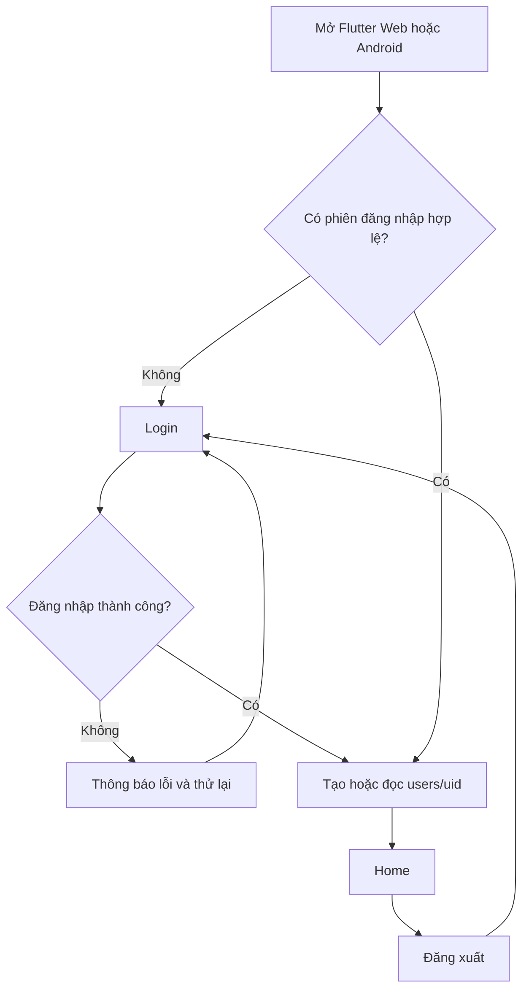
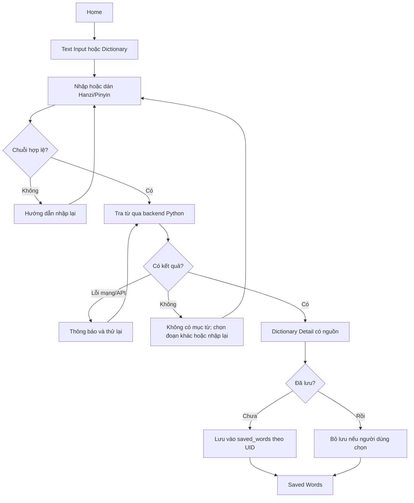
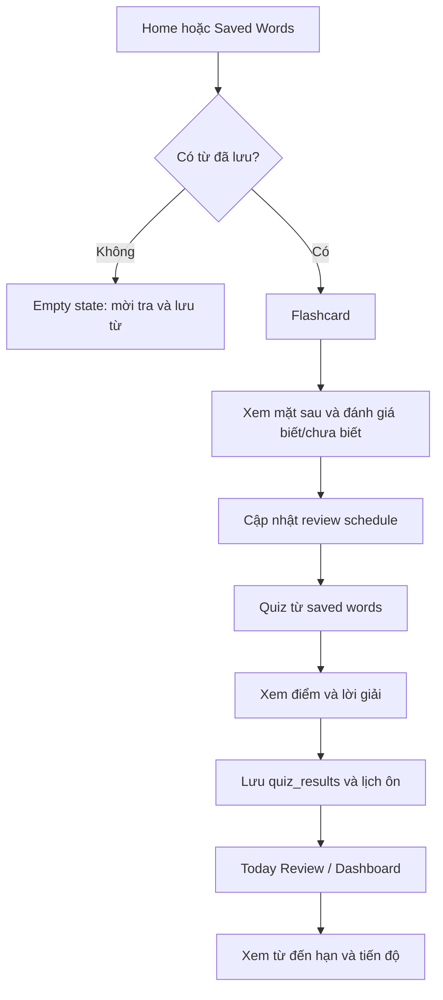
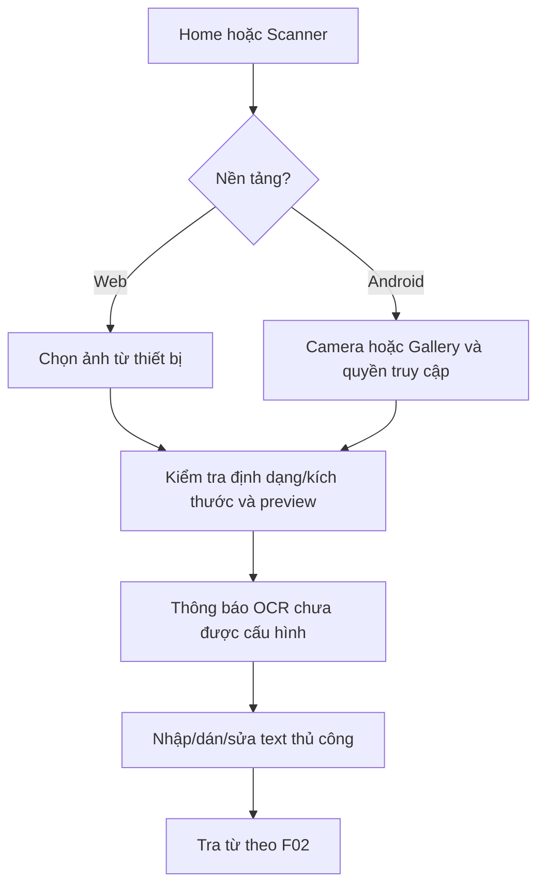
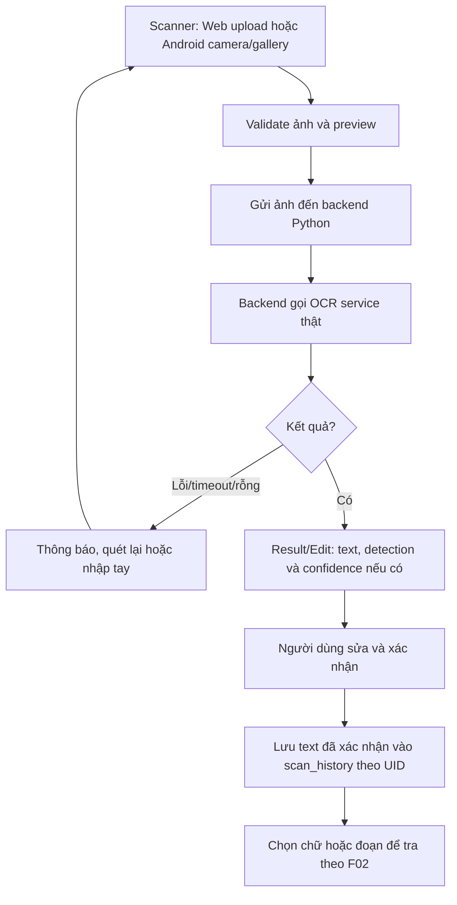
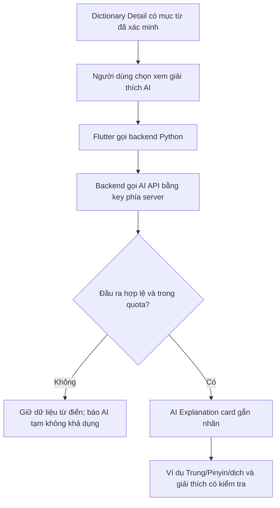

# HanLearn AI — user flows

> Issue `HL-00-02` · 2026-11-20 · Nguồn yêu cầu: `product-requirements.md` (UC-01 đến UC-09). Đây là flow sản phẩm; layout cụ thể thuộc `HL-00-03`.

## Quy ước

- `Core`: có trước OCR/AI thật, dùng nhập/dán văn bản thủ công.
- `MVP cuối`: mở rộng core bằng OCR service thật và AI API thật qua backend Python.
- Cùng một Flutter codebase chạy Web và Android; đường vào ảnh khác nhau nhưng trạng thái sau khi đã chọn ảnh phải nhất quán.
- Chỉ dữ liệu đã được người dùng xác nhận mới được ghi vào lịch sử quét. Các bước tra và học không phụ thuộc AI hoạt động.

## F01 — Tài khoản và vào ứng dụng (core)

**Điều kiện:** Firebase khả dụng; ít nhất một phương thức đăng nhập được cấu hình ở Phase 02. Khi mất mạng/phiên hết hạn, thông báo trạng thái và cho thử lại; không hiển thị dữ liệu người khác. Cùng UID trên hai nền tảng đi đến cùng dữ liệu cá nhân.

## F02 — Nhập tay, tra cứu và lưu từ (core)

**Quy tắc:** không tự tạo nghĩa/Pinyin để lấp dữ liệu thiếu; có thể chọn thủ công một đoạn chữ để tra. Lưu trùng phải idempotent. Nếu Firestore chưa xác nhận lưu, UI không thông báo đã đồng bộ. Việc tra từ vẫn khả dụng khi AI lỗi hoặc chưa tích hợp.

## F03 — Học, kiểm tra và xem tiến độ (core)

**Quy tắc:** câu bỏ qua không tính đúng; Quiz không đưa lựa chọn trùng/không hợp lệ. Lịch ôn có công thức và timezone được chốt ở Phase 04. Khi mất mạng, hiển thị trạng thái lưu/sync thật; không báo hoàn tất trước khi dữ liệu cá nhân được xác nhận. Đăng xuất/đăng nhập hoặc đổi nền tảng vẫn thấy dữ liệu đã đồng bộ.

## F04 — Chọn ảnh trước khi OCR sẵn sàng (core, Phase 06)

**Quy tắc:** không tạo kết quả OCR giả. Ảnh lỗi/không được cấp quyền có trạng thái lỗi và đường thử lại. Chọn ảnh một mình không làm phát sinh lịch sử quét.

## F05 — Ảnh → OCR → sửa → tra (MVP cuối, Phase 09)

**Quy tắc:** OCR chỉ nhận chữ Hán giản thể in trong MVP. Confidence thấp phải được cảnh báo khi service cung cấp confidence. Không lưu ảnh nhạy cảm dài hạn mặc định. Giữ phân biệt text OCR ban đầu và text sửa theo schema được chốt ở `HL-00-05`/`HL-00-06`. Nếu backend/service lỗi, đường nhập tay vẫn dùng được.

## F06 — Giải thích AI (MVP cuối, Phase 10)

**Quy tắc:** AI không ghi đè nghĩa/Pinyin từ điển; phân tích bộ thủ chỉ khi có căn cứ. Key không gửi về client. Không lấy output model làm dữ liệu chuẩn.

## Ma trận luồng và màn hình

| Flow | Màn hình chính | Web | Android | Mốc |
|---|---|---|---|---|
| F01 | Login, Home, Profile | Có | Có | Core |
| F02 | Text Input, Dictionary, Saved Words | Có | Có | Core |
| F03 | Flashcard, Quiz, Today Review, Dashboard | Có | Có | Core |
| F04 | Scanner/Preview/Manual Edit | Upload file | Camera/Gallery | Core UI |
| F05 | Scanner, Result/Edit, Scan History | Upload file | Camera/Gallery | MVP cuối |
| F06 | Dictionary Detail, AI Explanation | Có | Có | MVP cuối |

## Lỗi và đường phục hồi chung

| Tình huống | Trạng thái hiển thị | Người dùng có thể làm tiếp |
|---|---|---|
| Chưa đăng nhập/phiên hết hạn | Yêu cầu đăng nhập | Đăng nhập lại; không xem dữ liệu cá nhân |
| Không có mục từ | Empty state có ngữ cảnh | Nhập/chọn đoạn khác |
| Mất mạng khi tra/lưu | Lỗi và trạng thái sync thật | Thử lại; không nhận đã lưu khi chưa xác nhận |
| Không có saved word | Empty state Flashcard/Quiz | Quay về Dictionary để lưu từ |
| OCR chưa cấu hình | Thông báo rõ | Nhập tay |
| OCR ảnh lỗi/timeout/không có text | Lỗi có thể thử lại | Quét lại hoặc nhập tay |
| AI lỗi/quá quota | AI tạm không khả dụng | Tiếp tục dùng dữ liệu từ điển |

## Truy vết

F01 → UC-01; F02 → UC-02/UC-03; F03 → UC-04/UC-05/UC-06; F04/F05 → UC-07/UC-09; F06 → UC-08 trong `product-requirements.md`. Wireframe cụ thể của từng màn thuộc `HL-00-03`; API và lưu dữ liệu thuộc `HL-00-05`/`HL-00-06`.
